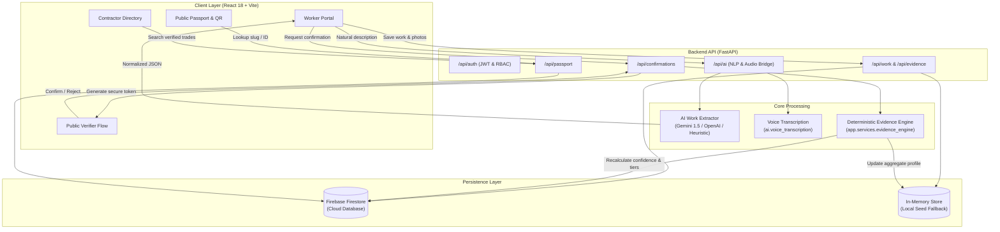

# VOUCH — Evidence-Backed Professional Identity for Skilled Trades

[](https://www.python.org/)
[](https://fastapi.tiangolo.com/)
[](https://react.dev/)
[](https://www.typescriptlang.org/)
[](https://vitejs.dev/)
[](https://tailwindcss.com/)
[](https://firebase.google.com/)
[](LICENSE)

> **"Your work. Vouched for."**  
> A mobile-first, worker-owned digital credential layer that converts real-world trade experience into verified, portable, and explainable professional passports.

---

## Overview

### The Problem
Millions of skilled tradespeople (electricians, plumbers, carpenters, welders, HVAC mechanics, construction specialists) build deep practical expertise over decades of work. However, their professional track record is fragmented across unorganized WhatsApp chats, job-site photos on mobile devices, lost paper receipts, and perishable verbal references. When switching employers, moving to another city, or negotiating pay with contractors, skilled workers lack a credible, tamper-evident proof of what they have actually built.

### The Solution
**VOUCH is not a job marketplace, an agency, or a review platform.** It is a **professional identity and evidence layer** owned entirely by the worker. 

With VOUCH, a tradesperson can:
1. **Log work via natural language or voice** (in English or Hindi).
2. **Automatically standardize trade skills and quantities** using AI extraction.
3. **Attach ground-truth evidence** (photos, completion certificates, work orders).
4. **Request zero-friction attestations** from customers, site supervisors, and employers via instant tokenized links.
5. **Generate an explainable evidence score** across specific skills.
6. **Share a tamper-evident Public Professional Passport** via a clean web link or printable QR code.

### Why It Matters
A worker's reputation should not disappear when they change employers or work sites. VOUCH decouples professional credibility from centralized gatekeepers, empowering workers to carry verified proof of their trade skills wherever they go.

---

## Key Features

- **AI-Powered Natural Language & Voice Work Logging**: Workers describe jobs in everyday conversational language (speech or text in English or Hindi). The AI engine normalizes the input into standardized trade categories, skill tags, metrics, and dates with deterministic fallback support when offline.
- **Deterministic Evidence Confidence Engine**: Calculates an explainable, bounded confidence score (0–98%) per skill. Confidence is mathematically derived from base declarations (+10), photographic proof (+15 each, max 30), documentation/certificates (+20-25, max 35), and third-party confirmations (+25 customer, +35 supervisor/employer).
- **Zero-Friction Verifications**: Verifiers (supervisors, clients, employers) sign off on specific work items via secure, single-use token links in under 30 seconds without creating accounts or downloading software.
- **Public Professional Passport**: A clean, shareable credential document featuring worker bio, verified trade history, high-resolution evidence galleries, breakdown of verifications, and instant QR code generation.
- **Contractor & Employer Directory**: A search-and-inspect portal allowing contractors to filter verified tradespeople by trade and location, inspect authentic site evidence, and contact pre-verified workers directly.
- **Native Bilingual Support (i18n)**: Seamless live language switching between English and Hindi (`hi`) across all screens, tailored for India's skilled workforce.
- **Hybrid Cloud / In-Memory Resilience**: Direct integration with Google Cloud Firebase Firestore and Firebase Admin SDK, paired with automatic zero-configuration in-memory caching for standalone demonstrations and offline testing.
- **JWT & Firebase Authentication**: Role-based access control supporting worker registration, password login, and Google Sign-In with automatic worker profile provisioning.

---

## How It Works / Architecture

### Data Flow & Verification Loop



### Architectural Principles

1. **Separation of Work Claims from Evidence**: A worker's self-declaration provides baseline context (10%), but high confidence tiers (`MEDIUM` 40-69%, `HIGH` 70-98%) strictly require tangible artifacts (photos/documents) and independent third-party confirmations.
2. **AI as Infrastructure, Not the Product**: AI is strictly scoped to natural language structuring and skill categorization. AI is **never** used to assign confidence scores or evaluate worker competency.
3. **No Verifier Account Wall**: Requiring site supervisors or residential clients to register an account before signing off causes 90%+ drop-off. VOUCH issues secure, one-click verification tokens that render minimal verification screens directly in any mobile browser.
4. **Backend-Centric Validation**: All evidence confidence math and data mutations run through FastAPI services to maintain deterministic data integrity.

---

## Tech Stack

| Layer | Technology | Rationale |
|---|---|---|
| **Frontend Core** | React 18 + TypeScript | Component modularity, reactive state management, and end-to-end type safety. |
| **Frontend Styling** | Tailwind CSS + Lucide Icons | Responsive mobile-first design adhering to the Utilitarian Credential Passport design system. |
| **Build Tool** | Vite 6 | Rapid HMR during development and optimized production tree-shaking. |
| **Internationalization** | React Context (`i18n`) | Lightweight, zero-dependency English and Hindi translation dictionary. |
| **Backend Framework** | FastAPI (Python 3.12) | Asynchronous REST performance, automatic Swagger/OpenAPI documentation, and native Pydantic schema validation. |
| **Data Validation** | Pydantic v2 | Strict serialization and contract enforcement across API boundaries. |
| **Database** | Firebase Firestore | Schema-flexible document database ideally structured for the worker-skill-evidence graph. |
| **Cloud Integration** | Firebase Admin SDK | Server-side Firestore operations and secure Google token verification. |
| **AI Extraction** | Google Gemini 1.5 Flash / OpenAI GPT-4o-mini | Low-latency trade entity extraction and skill taxonomy mapping with heuristic regex fallbacks. |
| **Speech Processing** | `ai.voice_transcription` | Multi-provider speech-to-text bridge with audio format validation and automatic provider failover. |
| **QR Code Engine** | `qrcode` (npm) + `qrcode[pil]` (Python) | Instant dynamic QR code generation for on-site sharing and physical business card integration. |

---

## Project Structure

```text
VOUCH/
├── .env.example                 # Root environment template
├── README.md                    # Primary project documentation
├── start-dev.bat                # Windows concurrent dev startup script
├── ai/                          # Standalone AI/ML research and transcription bridge
│   ├── README.md                # AI service overview
│   ├── smoke_test_voice.py      # Voice transcription smoke test utility
│   ├── voice_transcription/     # Audio validation, providers, and speech-to-text engine
│   └── worker_extraction/       # LLM prompts, fallback extractors, and data models
├── backend/                     # FastAPI application backend
│   ├── .env                     # Local backend configuration
│   ├── requirements.txt         # Python package dependencies
│   ├── serviceAccountKey.json   # Firebase Admin service credentials (optional)
│   ├── app/
│   │   ├── main.py              # Application entry point, middleware & route registration
│   │   ├── api/                 # REST controllers (auth, workers, work, evidence, passport, ai)
│   │   ├── core/                # App settings, Firebase Admin client, password hashing
│   │   ├── schemas/             # Pydantic v2 domain schemas and response contracts
│   │   └── services/            # Core business logic:
│   │       ├── ai_service.py    # LLM extraction & rule-based fallback
│   │       ├── auth_service.py  # User registration, JWT sessions & password validation
│   │       ├── data_service.py  # Firestore persistence layer & seed synchronization
│   │       ├── evidence_engine.py # Deterministic 0–100 evidence confidence algorithm
│   │       └── voice_service.py # Audio transcription service bridge
│   └── tests/                   # Pytest test suite (auth, golden path, schemas, voice)
├── docs/                        # Architecture & product source-of-truth documents
│   ├── 01-product-spec.md       # Product vision, user personas & functional scope
│   ├── 02-engineering-architecture.md # System architecture boundaries
│   ├── 03-data-model.md         # Firestore collection models & relations
│   ├── 04-api-contract.md       # REST endpoint specifications
│   ├── 05-ui-design-system.md   # Visual tokens, colors & typography guidelines
│   ├── 06-ai-evidence-engine.md # Deterministic scoring formulas and anti-gaming rules
│   ├── 07-hackathon-execution.md# Implementation timeline & integration rules
│   └── 08-demo-script.md        # Golden path demonstration script
└── frontend/                    # Vite + React + Tailwind frontend application
    ├── package.json             # NPM dependencies & scripts
    ├── tailwind.config.js       # Design tokens, color palette & typography
    ├── vite.config.ts           # Vite configuration and server proxy rules
    └── src/
        ├── App.tsx              # Application router & provider setup
        ├── index.css            # Global CSS styles & design tokens
        ├── components/          # Reusable UI components (Navbar, Footer, Modals, Cards)
        ├── context/             # AppState context (active worker, work records, auth)
        ├── i18n/                # English and Hindi localization provider and dictionaries
        └── pages/               # Application view controllers:
            ├── WorkerAppPage.tsx        # Worker dashboard, log work, evidence manager
            ├── ContractorAppPage.tsx    # Employer/Contractor review portal
            ├── PublicVerifierPage.tsx   # Verifier decision page (/verify/:token)
            └── PublicWebsite/           # Marketing, Directory, Login, Passport pages
```

---

## Getting Started

### Prerequisites
- **Python**: Version `3.10` or higher (`3.12` recommended)
- **Node.js**: Version `18.0` or higher (`20+` recommended)
- **Package Managers**: `pip` and `npm`

---

### Step 1: Clone the Repository

```bash
git clone https://github.com/zainkp/VOUCH.git
cd VOUCH
```

---

### Step 2: Configure Environment Variables

#### Backend Configuration
Copy `.env.example` in `backend/` (or configure `backend/.env` directly):

```bash
cd backend
cp .env.example .env
```

Key configuration variables (`backend/.env`):
```ini
PORT=8000
FIREBASE_PROJECT_ID=vouch-app1
FIREBASE_SERVICE_ACCOUNT_PATH=serviceAccountKey.json
# Optional: Add keys for live LLM extraction (fallback heuristic runs automatically if empty)
GEMINI_API_KEY=your_gemini_api_key_here
OPENAI_API_KEY=your_openai_api_key_here
CORS_ORIGIN=http://localhost:5173
```

> **Note**: If `serviceAccountKey.json` or `GEMINI_API_KEY` is not present, VOUCH will start automatically using its high-fidelity in-memory seed database and rule-based NLP fallback.

#### Frontend Configuration
Copy `.env.example` in `frontend/`:

```bash
cd ../frontend
cp .env.example .env
```

Key configuration variables (`frontend/.env`):
```ini
VITE_API_URL=http://127.0.0.1:8000/api
```

---

### Step 3: Backend Setup & Execution

```bash
# 1. Navigate to backend directory
cd backend

# 2. Create and activate a Python virtual environment
# Windows:
python -m venv venv
.\venv\Scripts\activate
# macOS/Linux:
# python3 -m venv venv
# source venv/bin/activate

# 3. Install dependencies
pip install -r requirements.txt

# 4. Start the FastAPI development server
uvicorn app.main:app --host 127.0.0.1 --port 8000 --reload
```

- **API Base URL**: `http://127.0.0.1:8000/api`
- **Interactive Swagger Docs**: `http://127.0.0.1:8000/docs`
- **Health Check**: `http://127.0.0.1:8000/api/health`

---

### Step 4: Frontend Setup & Execution

In a new terminal window:

```bash
# 1. Navigate to frontend directory
cd frontend

# 2. Install dependencies
npm install

# 3. Start Vite development server
npm run dev
```

- **Frontend Application**: `http://localhost:5173`

---

### Quick Launch (Windows)

A single-click batch script is included in the project root:

```cmd
.\start-dev.bat
```

This concurrently boots the FastAPI backend on port `8000` and the Vite frontend on port `5173` in separate background terminals.

---

## Usage & API Examples

### 1. Health Check
```bash
curl -X GET http://127.0.0.1:8000/api/health
```
```json
{
  "status": "healthy",
  "service": "VOUCH API",
  "version": "1.0.0"
}
```

### 2. AI Work Record Extraction
Send a natural-language description of work performed:
```bash
curl -X POST http://127.0.0.1:8000/api/ai/extract-work \
  -H "Content-Type: application/json" \
  -d "{\"text\": \"I installed and wired six 415V commercial distribution panels at Mangalore Trade Center.\"}"
```
```json
{
  "title": "Commercial Panel Installation",
  "trade": "Electrical",
  "skills": ["Panel Installation", "Commercial Electrical"],
  "quantity": 6.0,
  "quantity_unit": "panels",
  "date": "2026-10-07",
  "location": "Mangaluru",
  "confidence": 0.88,
  "summary": "Completed commercial panel installation with demonstrated expertise in Panel Installation, Commercial Electrical."
}
```

### 3. Retrieve Worker Profile & Confidence Breakdown
```bash
curl -X GET http://127.0.0.1:8000/api/workers/me
```

### 4. Fetch Public Passport
```bash
curl -X GET http://127.0.0.1:8000/api/passport/ravi-kumar-82a7
```

---

## Testing

The backend includes a comprehensive `pytest` suite validating core workflows, authentication tokens, schema serialization, voice transcription, and the end-to-end golden path.

### Running Backend Tests

```bash
cd backend
python -m pytest tests/ -v
```

Test coverage includes:
- `test_golden_path.py`: Complete user journey from work logging to AI extraction, evidence upload, supervisor attestation, and public passport verification.
- `test_auth.py`: User registration, password hashing, JWT creation, Google ID token verification, and duplicate collision guards.
- `test_schemas.py`: Pydantic model validation and constraints.
- `test_profile_extraction.py`: Multi-provider LLM extraction and deterministic fallback accuracy.
- `test_voice_transcription.py`: Audio format constraints, transcription mocks, and multi-provider failover.
- `test_employer_and_directory.py`: Worker search and employer lookup filters.

### Running Frontend Type & Build Validation

```bash
cd frontend
npm run build
```

Compiles TypeScript without errors and produces optimized production bundles into `frontend/dist`.

---

## Roadmap

Based on the project's engineering specifications (`docs/`), the following enhancements are planned:

- [ ] **Offline-First PWA & Background Sync**: Allow workers to log jobs and photograph work offline on remote job sites, syncing to the cloud when network returns.
- [ ] **Multi-Party Formal Audits**: Enable accredited trade councils and licensing boards to sign off on formal credentials to unlock 100% audited status.
- [ ] **Verifier Trust & Anomaly Detection**: Implement cross-worker verifier consistency checks and duplicate photo hash detection to prevent fraudulent attestations.
- [ ] **Expanded Regional Languages**: Add support for Kannada (`kn`), Tamil (`ta`), Telugu (`te`), and Marathi (`mr`).
- [ ] **Portable Digital Badges (Open Badges 3.0 / W3C Verifiable Credentials)**: Export public passports into standard verifiable credential formats for government and international trade recognition.

---

## Contributing

Contributions, issues, and feature requests are welcome!

1. Fork the repository (`https://github.com/zainkp/VOUCH/fork`).
2. Create your feature branch (`git checkout -b feature/AmazingFeature`).
3. Commit your changes (`git commit -m 'Add some AmazingFeature'`).
4. Push to the branch (`git push origin feature/AmazingFeature`).
5. Open a Pull Request.

---

## License

This project is licensed under the **MIT License**. See the [LICENSE](LICENSE) file for details.

---

## Author & Acknowledgements

- **Developer**: Zain ([@zainkp](https://github.com/zainkp))
- **Email**: [zainkp777@gmail.com](mailto:zainkp777@gmail.com)
- **Repository**: [https://github.com/zainkp/VOUCH](https://github.com/zainkp/VOUCH)
- **Built for**: CSE Hackathon — Empowering skilled and informal workers with verified digital professional identity.
